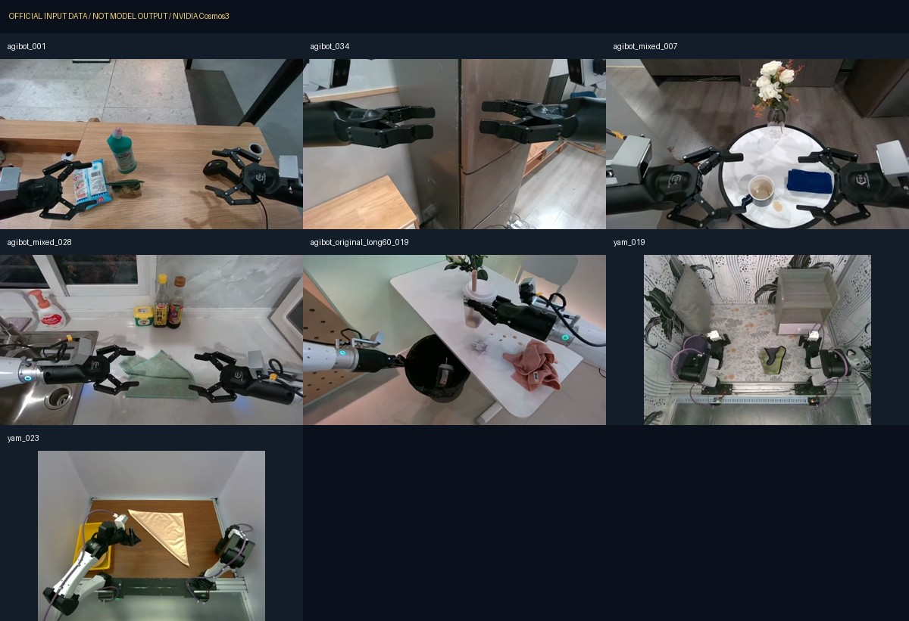
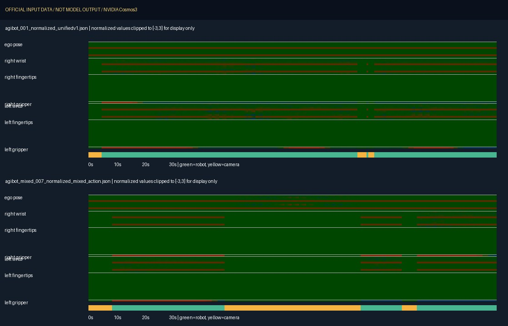
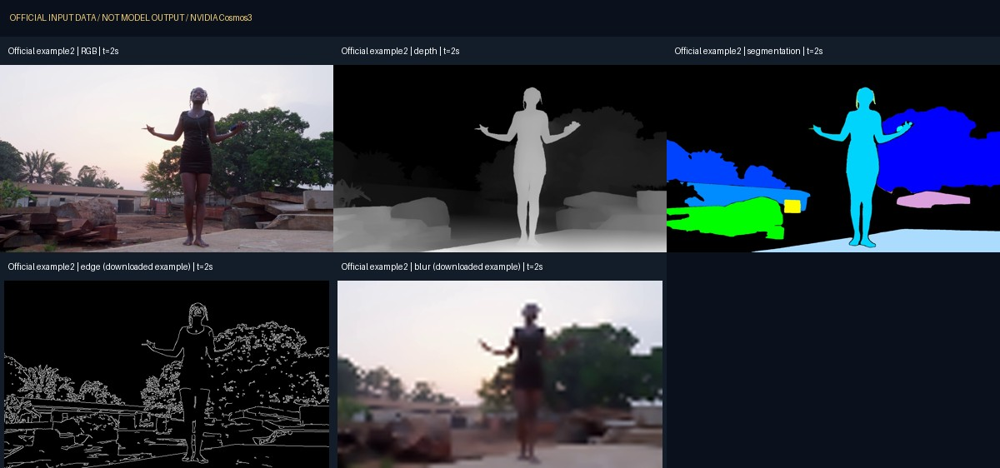
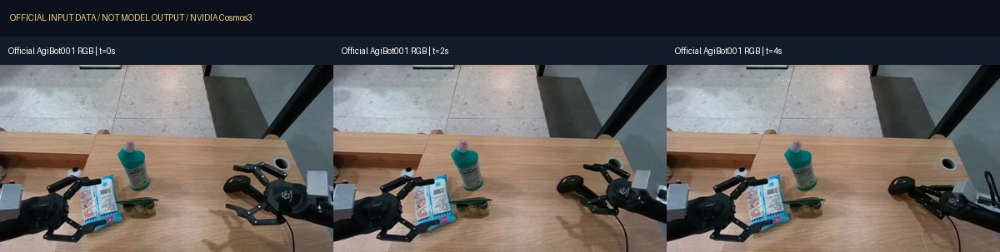

# Cosmos3 Robotics Simulation

**Cosmos 机器人世界模型复现、输入可视化与边界测试。**

[](https://github.com/PHCbhhgd/Cosmos3-Robotics-Simulation/actions/workflows/ci.yml)


[复现步骤](docs/REPRODUCTION.md) · [输入输出](docs/INPUT_OUTPUT.md) · [测试报告](docs/TEST_REPORT.md) · [测试矩阵](configs/test_matrix.json) · [运行证据](reports/README.md)

这是独立于 [Cosmos3 Driving Simulation](https://github.com/PHCbhhgd/Cosmos3-Driving-Simulation) 的机器人专项项目。重点研究给定动作后机器人与物体的视觉变化，以及空间控制下的机器人视频生成。

**当前为可复现的准备与输入测试版本：已通过官方输入校验和本项目 CPU 检查；尚未在本机完成机器人模型推理。下方图片全部来自官方输入或官方记录视频，不是本机生成结果。**

GitHub 只保存代码、配置、报告与预览图；权重、完整视频、上游源码及运行日志留在本地。公开单文件上限为 10 MiB。

## 两个模型分别做什么

| 模型 | 输入 → 输出 | 本次状态 |
| --- | --- | --- |
| [Cosmos3-Nano-Sim-Bimanual](https://huggingface.co/nvidia/Cosmos3-Nano-Sim-Bimanual) | 文本 + 初始 RGB + 59 维归一化动作轨迹 → 未来 RGB 视频 | 7 个独立官方样例通过官方校验；异常输入测试通过；GPU 生成待运行 |
| [Cosmos3-Nano-Sim-Transfer](https://huggingface.co/nvidia/Cosmos3-Nano-Sim-Transfer) | 文本 + 深度 / 分割 / 边缘 / 模糊控制之一 → RGB 视频 | 官方四种请求与机器人 edge / blur 请求已准备；GPU 生成待运行 |

Bimanual 预测给定动作的视觉后果，**不负责规划动作**。Transfer 主要生成受控外观，**不提供物理引擎或机器人关节真值**。这两条原生路径均不直接输出 LiDAR 点云、力矩或触觉，也不能仅凭视频可播放就认定抓取成功。

## 双臂样例：机器人最初看到了什么



上图展示已下载的 AgiBot 与 YAM 初始观察。每个样例配有原始 caption、动作 sidecar 和机器人域信息。清单中的 10 行对应 7 个独立样例，混合动作与长序列在多个清单中重复出现。



热力图来自真实官方 59 维动作：横轴时间、纵轴动作通道；绿色条为机器人域，黄色条为相机域。数值已经归一化，**不是直接以米或弧度表示**。图中仅为显示裁剪到 `[-3,3]`，推理输入不会被裁剪或再次归一化。具体字段见[输入输出说明](docs/INPUT_OUTPUT.md)。

## Transfer：先区分官方通用样例和机器人专项样例



官方 `example2` 是人物运动，用来核对 depth、seg、edge、blur 原生推理流程。上图 edge / blur 是下载的示意素材；实际请求使用 RGB，由原生管线**先缩放，再计算控制图**。



机器人专项请求使用官方 AgiBot 001 记录视频的前 121 帧，分别准备 edge / blur 控制。尚未构造机器人 depth / seg 测试，因为当前素材没有对应的标定深度或语义真值。

## 已经测试到了哪一步

| 检查 | 实际结果 | 证据 |
| --- | --- | --- |
| 固定 Framework 提交的官方锁文件 | uv 0.11.29 `lock --check` 通过 | [环境检查](reports/runtime-checks.json) |
| 原生推理入口导入 | `inference --help` 返回 0 | [环境检查](reports/runtime-checks.json) |
| 官方 Bimanual 清单 | 10 行 / 7 个独立样例通过 | [官方校验报告](reports/bimanual-official-preflight.json) |
| 动作异常输入 | 9 类错误均被官方校验器拒绝 | [边界报告](reports/bimanual-boundaries.json) |
| 输入视频完整性 | 7 个视频完整解码、帧数和 FPS 匹配 | [输入视频报告](reports/input-videos.json) |
| 本项目 CPU 回归 | 输入切片、路径、启动参数与公开文件检查 | [测试说明](docs/TEST_REPORT.md) |
| GPU 生成与视觉质量 | **未运行**；观测时 8 张 GPU 均有计算任务 | [硬件快照](reports/preflight.json) |

RTX 4090 / sm89 的机器人 `three_way` 注意力兼容性还未验证。不能把驾驶 Sim-Auto 的硬件拒绝结果套用到这两个模型。每个 BF16 Transformer 主权重约 30.3 GB，单张 24 GiB 显卡无法容纳完整未分片主权重；多卡分片方案也需要实际验证。

## 从哪里开始复现

```bash
# 无 GPU、无权重的仓库检查
python -m unittest discover -s tests -v
python scripts/audit_public_repo.py

# 下载官方输入；完整权重需加 --weights，全部留在 storage/
python scripts/download_assets.py bimanual
python scripts/download_assets.py transfer

# 准备动作驱动的短测试；完整 baseline 不传 --action-count
python scripts/prepare_inputs.py bimanual --action-count 32 \
  --output artifacts/bimanual-smoke
```

完整环境安装、模型下载、官方校验、GPU 内核探测、推理命令和视频检查见[复现指南](docs/REPRODUCTION.md)。GPU 编号必须来自明确分配；启动脚本会拒绝正在运行计算任务的卡。

## 本地与 GitHub 的文件分工

| 目录 | 内容 | 上传 GitHub |
| --- | --- | --- |
| `scripts/`、`configs/`、`tests/` | 下载、准备、推理、检查与测试计划 | 是 |
| `docs/`、`reports/`、`media/` | 文档、精简证据、输入预览图 | 是 |
| `storage/` | 模型权重与完整官方素材 | 否 |
| `repos/` | 固定版本的官方 Framework | 否 |
| `artifacts/` | 本机请求、路径、缓存与原始日志 | 否 |
| `outputs/` | 后续模型生成视频与完整运行记录 | 否 |

代码采用 Apache-2.0；官方模型、素材及其预览沿用对应的 OpenMDW-1.1 条款，见 [第三方来源](THIRD_PARTY_NOTICES.md)。本项目不是 NVIDIA 官方项目。
