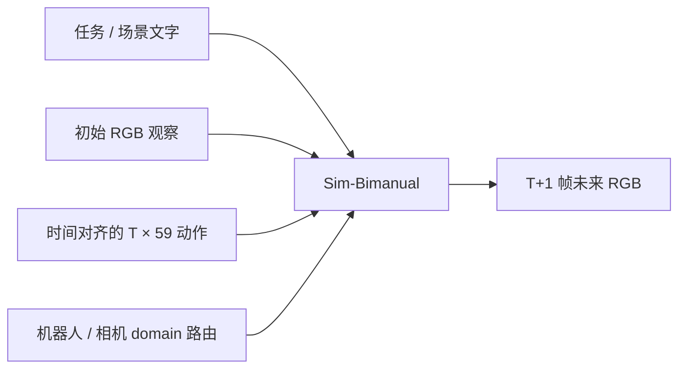
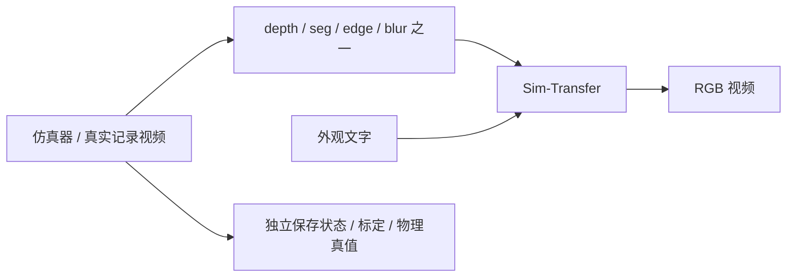

# 输入、输出与仿真边界

## Sim-Bimanual：动作驱动的视觉动力学

动作由外部数据、策略或人工校准轨迹提供。模型预测观察变化，不能代替动作策略。

当前发布版本要求 `conditioning.schema_version=5`、`action_space=normalized_unified_v1`。每个动作包含 59 个有限数值，模型内部补 5 个零通道至 64 维。`T` 必须为正数且可被 4 整除；`num_frames=T+1`，`action_chunk_size=T`。公开清单通常为 900 动作 / 901 帧 / 30 FPS，另有 1800 动作 / 1801 帧。

| 通道，0 起始、含首尾 | 含义 | 说明 |
| --- | --- | --- |
| 0–8 | ego / 相机位姿 | 平移与 6D 旋转表示，采用 chunk 锚定约定 |
| 9–17 | 右腕位姿 | 需匹配机器人和数据坐标约定 |
| 18–32 | 右手指尖 | 仅支持这些通道的域有效 |
| 33 | 右夹爪开口 | 物理定义为米，但 sidecar 已归一化 |
| 34–42 | 左腕位姿 | 与右腕相同约束 |
| 43–57 | 左手指尖 | 并非所有双夹爪机器人均有指尖通道 |
| 58 | 左夹爪开口 | 同右侧 |

这些是统一动作表示，**不是 59 个电机关节角**。位姿采用 `backward_chunk_anchored_16f` 与 `rot6d_columns`，并有训练时的非线性归一化。不能把任意机器人关节轨迹直接填入，也不能把所有零值当成“机器人停止”。

每行可通过 `domain_names` 选择不同域。AgiBot 为 ID 15，相机为 ID 2，YAM 为 ID 16；具体映射以下载的 checkpoint 为准。相机行只有 0–8 有效，其余通道必须为零；AgiBot 等域也有各自的有效掩码。**无效通道须在归一化后置零；已准备的官方动作不能再次归一化。**

官方 AgiBot 001 也包含相机域动作，不能只看清单顶层 `domain_name` 就认定整段都是机器人域。实际数量见 [官方报告](../reports/bimanual-official-preflight.json)。

输入 RGB 只代表初始观察；未来动作的视觉后果由模型生成。多段预测或 session API 的存在，不等于本项目已经完成策略闭环。本轮仅准备开环请求。

## Sim-Transfer：空间控制下的视频生成

| 控制 | 约束内容 | 本项目输入来源 |
| --- | --- | --- |
| depth | 画面中的深度结构 | 官方通用 example2 深度视频；未标为机器人深度 |
| seg | 类别区域及轮廓 | 官方通用 example2 分割视频 |
| edge | 边缘、形状与运动轮廓 | 官方 example2 或真实机器人 RGB，原生管线计算 |
| blur | 粗略颜色、形状与布局 | 官方 example2 或真实机器人 RGB，原生管线计算 |

每次原生请求选一种控制，不能把四个请求误称为四路相机。`example2` 请求为 121 帧、30 FPS、832×480 输出画布；最后一帧采样时刻为 4 秒。

Edge / blur 在 RGB 缩放至模型画布后计算。depth 使用原生双线性策略，seg 使用最近邻策略；自行制作控制时不能混淆插值含义。下载的深度示例是一种模型控制表示，不能仅看灰度就把它解释为标定的米制传感器深度。

本项目机器人专项输入来自官方 `agibot_001_gt.mp4` 前 121 帧，保留原始 640×360 视频尺寸，在推理时由原生管线变换至 832×480。选取的片段会重新编码一次，完整来源与 SHA 保存在本地请求目录中。

## 视频输出可以证明什么

完整解码可以证明文件非空、帧数、FPS 和编码结构匹配。它不能证明接触合理、夹爪真实抓住物体、动作跟随正确、相机位姿正确或世界长期稳定。

机器人实验应同时保留动作、初始图像、实际 caption、seed、模型及源码版本、有效请求、过程日志、生成 RGB；有仿真真值时再保存关节、物体位姿、碰撞、深度和分割，并验证生成图像与这些标签的一致性。本项目当前尚无生成视频或上述物理评估结果。
