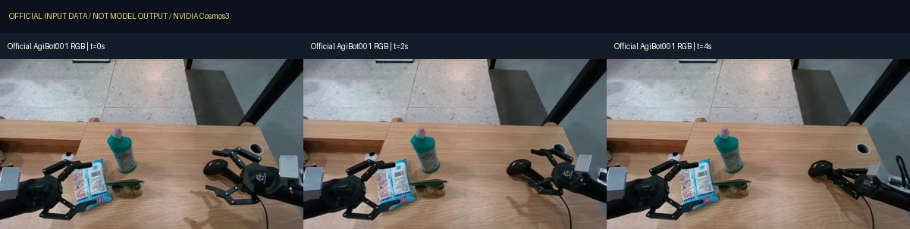

# 测试报告：准备与 CPU 输入验证

记录日期：2026-11-09。**没有完成 GPU 模型推理；没有生成质量、抓取成功率、实时速度或世界失稳时长结论。**

## 已执行检查

| 项目 | 实测结果 | 范围 |
| --- | --- | --- |
| 官方 Framework 锁文件 | uv 0.11.29 检查通过，解析 595 个包 | 未重新同步完整训练环境 |
| 原生推理入口 | Python 3.13.14 / PyTorch 2.10.0+cu130 下 `--help` 返回 0 | GPU 不可见，非 CUDA 内核检查 |
| Bimanual 官方输入 | 3 个清单、10 行全部通过；去重为 7 个样例 | 配置、采样日程、图像、动作和域有效性 |
| 官方动作校验器异常输入 | 有效基线接受；9 类异常均拒绝 | CPU 数据边界 |
| 官方 / 本地输入视频 | 7 个均完整解码、帧数和 FPS 匹配 | 输入文件结构，非输出质量 |
| 项目回归检查 | 6 项单元测试通过 | 输入切片、路径和启动配置、公有文件限制 |
| 公开文件审计 | 无大于 10 MiB 文件、凭据样式或本机绝对路径 | 不读取被忽略的私有运行目录 |

官方动作校验器实际拒绝：58 维动作、缺少一行动作、NaN、Infinity、布尔数值、错误动作空间、未知机器人域、逐行动作域长度不符，以及相机行含夹爪通道值。原因原文保存在 [bimanual-boundaries.json](../reports/bimanual-boundaries.json)。这些测试验证输入检查行为，不证明模型面对这些输入时仍能生成正确视频。

短输入准备还检查正数及 4 帧对齐、保留归一化数值和逐行域，不把合成全零动作当成停止。10 行官方结果的重复样例不重复计作独立测试成功。

## 输入视频与来源

| 输入 | 帧数 / FPS | 尺寸 | 说明 |
| --- | --- | --- | --- |
| example2 RGB | 121 / 30 | 1920×1080 | 官方人物运动输入 |
| example2 depth | 121 / 30 | 1920×1080 | 官方控制素材 |
| example2 segmentation | 121 / 30 | 1920×1080 | 官方控制素材 |
| example2 edge / blur | 各 121 / 30 | 832×480 | 下载示意；请求仍从 RGB 原生计算 |
| AgiBot 001 记录 RGB | 901 / 30 | 640×360 | 官方训练示例中的记录视频，不是本机生成 |
| 机器人短片输入 | 121 / 30 | 640×360 | 上述 RGB 前 121 帧，本地重新编码 |

完整解码与逐文件 SHA 见 [input-videos.json](../reports/input-videos.json)。视频最后采样时刻为 `(帧数-1)/FPS`：121 帧为 4 秒，901 帧为 30 秒；封装时长可能多一个帧周期。



## 当前阻塞与尚未验证项

观测时 8 张 RTX 4090 均有计算进程。项目的占用检查也已实际拒绝对繁忙 GPU 的启动，本轮没有停止、抢占或修改现有任务。硬件快照只发布卡型、显存和进程数量，不发布其他使用者的进程明细。

两个模型每个 Transformer 约 30.3 GB，权重下载只在本地进行；[preflight.json](../reports/preflight.json) 记录的是当时完整分片数量，下载过程中 `.partial` 不算完整文件。下载完成不能替代模型成功加载检查。

机器人模型为 `three_way` 注意力路径。官方模型卡列出 Hopper / Blackwell；当前 RTX 4090 是 sm89。**没有执行机器人模型 CUDA 内核或完整采样，因此兼容性为未知。** 驾驶 Sim-Auto 的 `multiview_maskless_kv` 拒绝不能作为这里的失败证据；仓库没有修改硬件 gate 来伪装成功。

复用环境中的 NATTEN 是 `0.21.6.dev6+cu130.torch210.gb300`。能够导入 CLI 不保证这个 wheel 支持所有 GPU 或注意力功能。完整环境应按固定 Framework 锁文件安装，再在已分配卡上先执行内核探测。

当前未完成：机器人动作跟随质量、物体与夹爪接触、混合域切换视觉质量、60 秒漂移、多卡分片容量、Transfer 控制保真、光照反事实和策略闭环。没有 OOM 或质量失败样本时，不编造失败边界。

## 接下来如何评估

所有待生成场景列在 [test_matrix.json](../configs/test_matrix.json)，状态均为 `planned_not_generated`。先执行 33 帧 Bimanual smoke，再完整官方样例；Transfer 先官方四控制基线，再机器人 edge / blur。

人工审核至少覆盖：手臂 / 夹爪动作方向、接触前后物体相对关系、物体数量与身份、遮挡后恢复、背景结构、闪烁及冻结。混合域必须根据真实 `domain_names` 的每次切换抽帧，不能假定只在第 10、20 秒切换。

长序列按秒抽帧并回看异常前后的完整视频，记录最早明确出现的问题及证据；不同场景、动作和 seed 分开记录。没有测到明确崩坏时应报告观测范围，不能推出无限稳定。

AgiBot 001 视频来自公开训练示例，不应作为独立 held-out 成绩。严格定量评估应另按官方 protocol 使用未见数据、相同时间对齐与明确指标。PSNR 也不能单独证明抓取或接触物理正确。

## 复查命令

```bash
python -m unittest discover -s tests -v
python scripts/audit_public_repo.py
python scripts/check_input_videos.py
```

最后一项需要先下载全部输入并准备 `artifacts/robot-transfer/`。CI 只运行轻量仓库检查，不下载权重或启动 GPU；绿色 CI 不代表机器人模型推理通过。
